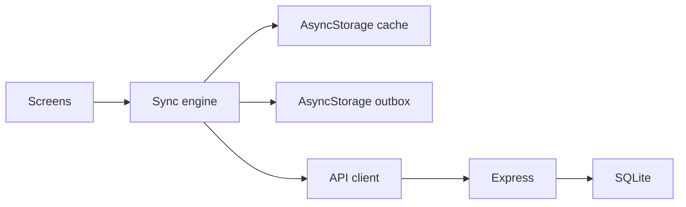

# Relay

Relay is an on-call handoff log. The person ending a shift writes what the next person must not have to rediscover: what broke, what they tried, and what to do if it pages again at 3am. The note is saved on the device first. The API gets it when it can.

## Run

You need Node.js 22 or newer (the API uses the built-in `node:sqlite` module) and npm. The phone app is Expo SDK 58.

From this directory:

```bash
cd /cursor/stores/bc-7ca2eae0-266b-469e-86e2-21b89c23959c/projects/relay
```

Start the API:

```bash
cd server
npm install
npm start
```

The API listens on `http://127.0.0.1:8787`. Check it with `curl http://127.0.0.1:8787/health`. A fresh database is seeded with four sample handoffs. Stop the process with Ctrl-C. Node 22 still marks `node:sqlite` as experimental; the start script hides that warning and no others.

`npm run smoke` in `server/` boots the API on a temporary database, checks the idempotency and status rules below, and exits.

Start the app from the project root:

```bash
cd /cursor/stores/bc-7ca2eae0-266b-469e-86e2-21b89c23959c/projects/relay
npm install
npx expo start
```

`npm install` uses the lockfiles. If it fails while renaming a package inside an existing `node_modules`, delete that folder and run it again. npm unpacks by renaming, and some network disks cannot.

Open it in Expo Go, an iOS simulator, or an Android emulator. The app calls `http://127.0.0.1:8787` unless you set `EXPO_PUBLIC_API_URL`. That default works for the iOS simulator. An Android emulator should use:

```bash
EXPO_PUBLIC_API_URL=http://10.0.2.2:8787 npx expo start
```

A physical device needs your computer's LAN address, for example `EXPO_PUBLIC_API_URL=http://192.168.1.20:8787`. Expo reads `EXPO_PUBLIC_*` when the bundle starts, so restart the bundler after changing it. The API binds to `0.0.0.0`, and `PORT` overrides 8787.

Typecheck the app, then the API and its smoke test:

```bash
npm run typecheck
npm run server:check
```

If SQLite reports `disk I/O error` (some network disks reject the database file), point it at a local path:

```bash
RELAY_DB=/tmp/relay.sqlite npm start
```

The database file otherwise lives at `server/data/relay.sqlite`.

## What you can do

- Read the night's handoffs, filtered to active, open, or everything.
- Open one and acknowledge or resolve it. Status only moves forward.
- Write a handoff with a headline, service, severity, notes, your handle, and an optional snapshot.
- Pull to refresh, or tap Sync. Coming back to the app retries anything still queued.
- Turn the API off, write a handoff, and kill the app. The note is still there. Start the API and Sync sends it once.

The snapshot is a placeholder. It stores a kind (`graph`, `dashboard`, `runbook`, or `pager`) and draws a stand-in. There is no camera and nothing is uploaded. The caption in the UI says so.

## Architecture



Screens never call `fetch`. They read a `useSyncExternalStore` snapshot and call `create`, `setStatus`, or `sync`.

Two local records stay separate:

- The **cache** is the last list the server successfully returned. It is a read model.
- The **outbox** is the write-ahead log. A create or a status change is durable on the device before any network call.

The list on screen is `mergeHandoffs(cache, outbox)`. Pending notes sort first. A corrupt cache or outbox entry is dropped on read; one bad row does not blank the log.

Creates use a client UUID. `POST /api/handoffs` inserts that id, and a repeat of the same id returns the original row. The title and notes from the first insert stay. Status moves only forward (`open` → `acknowledged` → `resolved`), including when a lost response is retried with a newer status. A backward move is `409`.

If you acknowledge a handoff that is still only in the outbox, that create is updated in place. The client does not `PATCH` an id the server has not seen, which would race the `POST`.

A `4xx` other than a stale status (`409`) or a missing status target (`404`) is marked rejected and is not retried on the timer. Pull to refresh, Sync, or opening the app tries it again. Timeouts, network failures, `429`, and `5xx` stop the rest of that pass and try on the next sync. Connectivity is decided by the request, not by a reachability API that can be wrong on a captive portal.

The handle you sign with is stored on the device and filled in next time.

The API is small on purpose. Express, a `node:sqlite` file, prepared statements, and a transaction around the read-modify-write of status. Validation is the server's own copy of the client's rules. Journal mode is `DELETE` rather than `WAL`, because this process is the only writer and WAL's extra files fail on some network disks.

### HTTP

| Method | Path | Behavior |
| --- | --- | --- |
| `GET` | `/health` | `{ ok: true, service: "relay-api" }` |
| `GET` | `/api/handoffs` | `{ handoffs }`, newest first |
| `GET` | `/api/handoffs/:id` | `{ handoff }` or `404` |
| `POST` | `/api/handoffs` | Create by client id. `201` the first time, `200` on a replay. A replay may advance status and will not rewrite the note. |
| `PATCH` | `/api/handoffs/:id` | `{ status }`. `409` if the status would move backward. |

`createdAt` on a create is the device clock, so a note written in a stairwell keeps that time. A status change accepted by the server is stamped on the server.

## Layout

```
relay/
  App.tsx                 navigation shell
  src/screens/            list, detail, create
  src/components/         cards, snapshot placeholder, fields
  src/services/           storage, API client, sync engine
  src/domain/             merge, validation, labels
  server/src/             Express, SQLite, smoke test
```

## What a mobile interviewer should notice

- The offline queue is a write-ahead log with client-generated ids, not a boolean "offline mode." Retries are safe because the server's create is idempotent and status is monotonic.
- A status edit during an in-flight `POST` does not get dropped. The engine only removes the outbox row if it still matches the payload that was sent. The next pass sends the newer status, and the server will not rewind.
- Reads and writes are different stores. Losing the network cannot erase a note you just wrote, and a slow list refresh cannot duplicate it.
- Rejected writes stop retrying themselves. The queue does not hot-loop a `400`.
- The repository sits behind `useSyncExternalStore`. A screen re-renders from a snapshot. It does not own a copy of the fetching policy.
- Local storage is versioned (`relay.outbox.v1`) and parsed with guards. Bad JSON opens an empty log instead of crashing the bridge.
- Severity is a word and a color. The card's accessibility label includes severity, title, status, and whether it is still queued. Primary actions are at least 48 points tall.
- The snapshot slot is an honest placeholder: it has a real field (`photoKind`) and a drawn stand-in, and the UI says nothing was uploaded. The product shape is there without a fake camera.
- The server stays boring. No ORM, no auth theater, prepared statements, one transaction for the status transition, and a smoke test that locks the idempotency contract.
- Validation is duplicated on purpose. The client is for the form. The API assumes the client is wrong.

## Not in this sample

Accounts, push, a real camera roll, multi-writer locking, and reopening a resolved handoff. A resolved note stays resolved; the next engineer writes a new one if the incident comes back.
